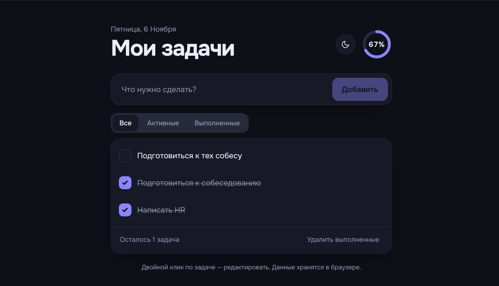

# Список задач

Простое и аккуратное веб-приложение для управления задачами. Один файл, никаких зависимостей и сборки: открыл `index.html` в браузере, и всё работает.


**Демо:** [ссылка на рабочий сайт](https://endropr.github.io/Todo-list-test-task-/)

## Возможности

- Добавление новых задач (по кнопке или клавишей Enter)
- Отметка выполненных задач
- Удаление задач
- Сохранение данных после обновления страницы (`localStorage`)

Дополнительно:

- Фильтры: все, активные, выполненные
- Редактирование задачи двойным кликом (Enter сохраняет, Esc отменяет)
- Удаление всех выполненных задач одной кнопкой
- Кольцо прогресса и счётчик оставшихся задач
- Светлая и тёмная темы: подстраиваются под систему, есть ручное переключение
- Адаптивная вёрстка, работает на телефоне и на десктопе
- Доступность: управление с клавиатуры, видимый фокус, ARIA-атрибуты, поддержка `prefers-reduced-motion`

## Технологии

- HTML5, CSS3 (CSS-переменные, grid и flexbox), чистый JavaScript (ES6+)
- Шрифт Onest (Google Fonts) с системным запасным вариантом
- Без фреймворков и сборщиков

## Запуск

```bash
git clone https://github.com/Endropr/Todo-list-test-task-.git
cd Todo-list-test-task-
open index.html   # macOS; на Windows: start index.html, на Linux: xdg-open index.html
```

### Публикация на GitHub Pages

1. Откройте **Settings → Pages**
2. В разделе **Build and deployment** выберите **Deploy from a branch**
3. Укажите ветку `main` и папку `/ (root)`, затем нажмите **Save**

## Структура проекта

```
.
├── index.html   # разметка, стили и логика приложения
├── screenshot.png # скриншот для README
└── README.md
```

## Как устроено хранение данных

Задачи хранятся в `localStorage` браузера под ключом `todo.tasks.v1` в виде JSON-массива:

```json
[{ "id": "lx3k9a1b2", "text": "Купить хлеб", "done": false, "created": 1730900000000 }]
```

Выбранная тема хранится под ключом `todo.theme`. Если `localStorage` недоступен (например, в приватном режиме), приложение продолжает работать, но без сохранения.

## Использованные AI-инструменты

Проект сделан с помощью **Claude (Anthropic)**. Я поставил задачу и требования к функциональности и дизайну, ИИ сгенерировал код. После этого я проверил работу в браузере и внёс правки.

## Лицензия

MIT
